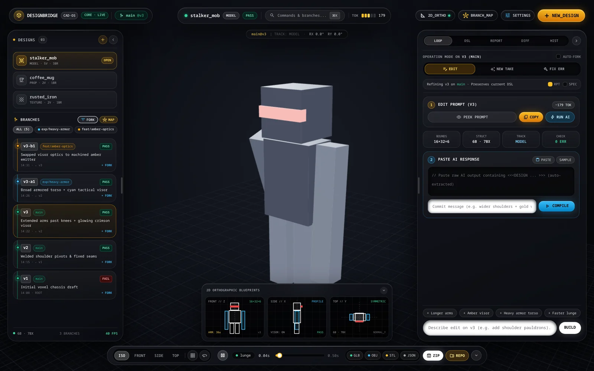
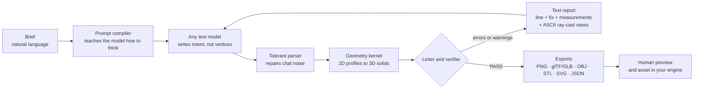
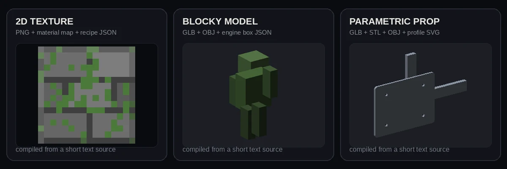
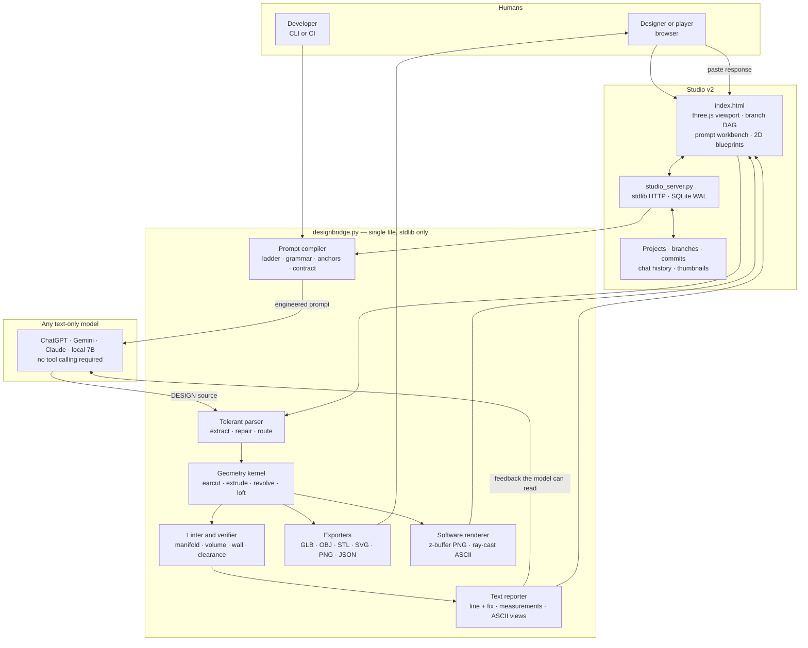

<div align="center">

# DesignBridge

**Give any text-only AI a real asset pipeline.**

ChatGPT, Gemini, Claude, or a local 7B model writes a short declarative design. DesignBridge compiles it into game-ready textures, animated 3D models, and printable props — with a text report the model can read and a real PNG you can see.

No tool calling. No API key. No third-party packages. No GPU needed to compile.

[](https://www.python.org/)
[](#zero-dependencies)
[](https://www.khronos.org/gltf/)
[](https://sqlite.org/)
[](https://en.wikipedia.org/wiki/Large_language_model)
[](#computer-science-under-the-hood)

[The problem](#the-problem) · [Three tracks](#three-tracks-one-language) · [Quick start](#quick-start) · [Free-tier workflow](#use-it-with-a-free-tier-chat-ai) · [The Studio](#the-studio) · [API](#api-reference)



*Studio v2 — live 3D viewport, git-style commit history, prompt workbench, and 2D orthographic blueprints.*

</div>

---

## The problem

Text models can't draw.

Not because they lack taste — because they have no eyes, no geometry kernel, and no way to check their own work. Ask for a mesh and you get invented vertices, broken syntax, and a result nobody can debug. Tool calling helps, but most people using free-tier ChatGPT or Gemini don't have it, and many local models don't either.

The bottleneck isn't the model's imagination. It's the missing compiler between the model and the asset.

## The bridge

DesignBridge puts one there.

The AI never emits pixels or vertices. It writes a short declarative description in a tiny domain-specific language. DesignBridge parses it, builds real geometry, measures it, renders it, and sends back a plain-text report the model can act on. You get a real PNG preview and files that open in Blender, a browser, Godot, Unity, or your own engine.

```text
brief ─▶ prompt ─▶ [ any AI ] ─▶ source text ─▶ compile ─▶ check ─▶ feedback
                        ▲                                              │
                        └────── palette / bone tree / ASCII views ◀────┘
                                   + a real PNG preview for you
                                                                       ▼
                     PNG · material map · glTF/GLB · engine JSON · STL · OBJ · SVG
```

The whole engine is one file. Pure Python 3.8+, standard library only — so it pastes straight into an AI's code sandbox and runs on a bare machine with nothing installed.

---

## The loop



Three ideas make the loop work:

1. **The model writes intent, not geometry.** A texture is a stack of named layers. A mob is coloured boxes grouped into bones. A prop is 2D profiles swept into 3D. The compiler owns the math.
2. **The compiler answers in the model's language.** Errors carry a line number and a concrete fix. Measurements expose wrong units. ASCII orthographic views expose wrong shapes. The model can debug without eyes.
3. **Failure is cheap.** Compile, read, repair, repeat. Nothing is hidden in a binary. The source is text, the report is text, and the history is saved.

---

## Features

| | Capability | Why it matters |
|---|---|---|
| 🧠 | **Prompt compiler** | Every prompt carries a role, a reasoning ladder, the complete grammar, real-world dimension anchors, a failure catalogue, a worked example, an output contract, and a self-check. Weak models produce valid assets instead of guesses. |
| 🧩 | **Three asset tracks** | One language for 2D tiles, blocky animated 3D, and smooth parametric CAD. The first keyword routes the source automatically. |
| 🛡️ | **Tolerant parser** | Extracts `<<<DESIGN>>>` from chatter, strips markdown fences, repairs smart quotes, accepts `key: value` where the grammar allows it, and suggests the nearest token, key, layer, or bone when the model misspells one. |
| 🔁 | **Blind-readable feedback** | Diagnostics carry a line, a message, and a fix. Measurements, palettes, bone trees, and ASCII views tell the model what it actually built. |
| 👁️ | **Human-readable preview** | A pure-Python software renderer writes a real shaded PNG — no GPU, no browser, no image library. |
| 🌿 | **Git-style studio** | Studio v2 stores projects, branches, commits, prompts, and chat history in SQLite with a filesystem mirror. Fork, merge, checkout, diff, restore. |
| 🔌 | **Direct LLM relay** | Optional server-side bridge for OpenAI-compatible, Gemini, or Ollama endpoints — no browser CORS pain. Or use the manual copy/paste loop, which needs no key at all. |
| 📦 | **Real formats** | GLB, OBJ, STL, SVG, PNG, material maps, recipe JSON, and engine-native box-model JSON. |
| 🪶 | **Zero dependencies** | The core and the studio server are pure Python standard library. Runs in an AI sandbox, a bare Fedora box, or a locked-down machine. |
| ✅ | **Verified kernel** | 11 reference solids, 9 deliberate failures, 200 random outlines, PNG validation, and GLB accessor checks all run in `selftest`. |

<a id="zero-dependencies"></a>
### Zero dependencies

`designbridge.py` imports only `sys`, `os`, `math`, `json`, `re`, `struct`, `argparse`, `hashlib`, `base64`, and `zlib`. No NumPy. No Pillow. No trimesh. No FastAPI. The geometry kernel, PNG encoder, glTF writer, software rasterizer, and HTTP server in the core — plus Studio v2's SQLite storage — are all built from the standard library.

That is not purity for its own sake. It means the same file can run inside a chat AI's code interpreter, on a machine with no package manager, or inside a build pipeline that refuses new dependencies.

> The Studio v2 browser UI loads Tailwind and three.js from a CDN on first load. The compiler itself remains fully offline.

---

## Three tracks, one language

The first real statement in a source file picks the track. Each track has a tolerant parser: all three extract the sentinel block and strip markdown fences, texture and prop sources repair smart quotes, and the prop parser also accepts `key: value` and evaluates arithmetic.

| Track | First word | Best for | Exports |
|---|---|---|---|
| **2D texture** | `texture` | Pixel-art tiles, block faces, material sets | Albedo PNG, `@16x` PNG, material map, recipe JSON |
| **Blocky 3D model** | `model` | Mobs, bosses, props with bones and keyframes | GLB, OBJ, box-model JSON, preview PNG |
| **Smooth 3D prop** | `design` / `profile` | Printable parts, pipes, machines, vases | GLB, STL, OBJ, profile SVG, preview PNG |



*Three real outputs, each compiled from a short text source: a 16×16 mossy cobble tile, the husk king mob, and an L bracket.*

### `texture` — 2D procedural tiles

A texture is a stack of layers painted in order: `fill`, `noise`, `brick`, `planks`, `scatter`, `veins`, `bevel`, `outline`, and more. The compiler paints a real tile, derives a tangent-space material map, and reports the palette back to the model.

```text
texture "mossy_cobble" size=16 roughness=0.9
fill color=#6b6b6b
noise dark=#55555570 light=#88888870 scale=3 amount=0.6
brick color=#6b6b6b mortar=#3f3f3f w=8 h=5 line=1 jitter=0.18
scatter color=#4a7a3a amount=0.22 seed=3
bevel light=#9a9a9a50 dark=#40404060
```

The material PNG packs **R,G = tangent normal, B = metallic, A = roughness** — the layout a procedural-atlas engine expects. A `recipe.json` preserves the layer stack so the tile can be repainted at another resolution.

### `model` — blocky 3D with animation

A model is coloured boxes grouped into named bones with pivots, plus keyframe animation. The pivot is the joint the bone rotates about, so a shoulder pivot sits at the top of the arm, not its centre.

```text
model "husk_king"
bone body pivot=(0,0,0)
  box from=(-7,0,-4) to=(7,16,4) color=#4a6a3a
bone arm_r parent=body pivot=(-7,15,0)
  box from=(-11,3,-3) to=(-7,16,3) color=#45603a
animation "attack" loop=false
  key arm_r t=0 rot=(0,0,0)
  key arm_r t=0.25 rot=(-120,0,0)
  key arm_r t=0.5 rot=(0,0,0)
```

This is where mobs, bosses, and their attack animations come from. The GLB carries the bones and animation channels; the box-model JSON is a flat list a blocky-mob renderer can load directly.

### `design` / `prop` — smooth parametric 3D

Props are 2D profiles swept into 3D with `extrude`, `revolve`, or `loft`. Hollow objects put the void in the 2D profile, so parts are watertight by construction instead of by luck.

```text
design "Twisted Vase" units=mm
profile shell
  ngon n=6 r=45
  hole ngon n=6 r=45-$wall.thin/0.866
solid body from=shell extrude h=180 twist=240 steps=90
```

Use this track for pipes, brackets, enclosures, mugs, vases, machines, and ruin details. `designbridge.py tokens` lists manufacturing-aware values such as wall thickness, clearances, fillets, screw holes, and print-bed limits.

---

## The prompt is the product

A naive request — *"write an OBJ of a mug"* — fails because the model has to invent coordinates it cannot verify. DesignBridge replaces that with a structured prompt that teaches the model how to answer before it writes a single line.

| Layer | What it does |
|---|---|
| **Role** | Tells the model it cannot see, must not emit mesh data, and will receive a report it can use. |
| **Reasoning ladder** | Function → generating view → construction strategy → dimension anchors → tolerance and wall → verify. Each rung produces a short written answer. |
| **Complete grammar** | Every shape, operation, token, and placement rule. Nothing is left implicit. |
| **Dimension anchors** | Real-world sizes: mug, hand, phone, M3 screw, USB-C, chair, desk, print bed. Sizes become believable. |
| **Failure catalogue** | The six failures that actually happen, with their causes and repairs. |
| **Worked example** | A mug built the right way, with the wall derived from a token and the cavity built by a revolve. |
| **Output contract** | Source goes between `<<<DESIGN` and `>>>`, alone, with no markdown fence and no prose. Whole source every round, never a patch. |
| **Self-check** | Silent questions before sending: are all profiles used, are inner dimensions derived, do the three extents match the committed size, could parts overlap? |
| **Repair protocol** | Fix errors first, judge warnings, compare the views, resend the whole document, change one thing per round. |

The prop prompt is about 11.7k characters; texture and model prompts are about 3k. They fit comfortably in free-tier context windows.

### For models with a shell: `--runnable`

If the AI can execute code — a local agent, a code interpreter, a CI bot — pass `--runnable`. The prompt then tells it to write `design.db`, run `check`, read the report, fix, and repeat until `STATUS: PASS`, then run `build`. That is a complete self-correcting asset agent with only one tool: a shell.

```bash
python3 designbridge.py prompt --kind prop --brief "a wall bracket for a 30mm pipe" --runnable
```

### The parser meets the model halfway

Chat models wrap answers in prose, use curly quotes, add markdown fences, and sometimes write `key: value` when the grammar says `key=value`. The parsers meet them halfway and log every repair, so the model can learn what it did:

- extracts the `<<<DESIGN ... >>>` block
- strips a markdown code fence
- repairs smart quotes in texture and prop sources, plus dashes and full-width punctuation in prop sources
- converts tabs to spaces in prop sources
- accepts `key=value`, `key = value`, and `key: value` in prop sources
- evaluates arithmetic and `$tokens` in prop sources
- suggests the nearest valid token, key, layer, bone, or reference with edit distance
- routes the source to the texture, model, or prop track by its first statement

---

## The feedback is the product

A compiler that only says *"invalid"* is useless to a blind model. DesignBridge reports like a patient reviewer.

```text
==================================================================
DESIGNBRIDGE 0.1.0   design 'bad'   units mm
STATUS: FAIL   1 error(s), 0 warning(s)
==================================================================

ERRORS -- 1 blocking problem(s). Affected solids were not built.
  [ERROR] line 2: wall between hole 1 and the outside of 'p' is 0.50mm - too thin to print
          FIX: keep at least ${wall.thin} = 1.2mm; shrink the hole or grow the outer shape
```

Passing reports add measurements, per-part volumes, and three orthographic views:

```text
MEASUREMENTS
  profiles 2   solids 2   parts 2   triangles 848
  bounding box   93.0 x 80.0 x 95.0 mm   (X x Y x Z)
  volume         79.89 cm^3   (79894 mm^3)
  every part closed   yes
```

The ASCII views are not ordinary wireframes. Each character is a ray fired through the solid, shaded by **how much material it crossed**. A hollow part reads as a bright rim around a dim middle. That single detail is how a model without eyes can tell a vessel from a plug.

```text
VIEWS -- three orthographic views. Shade = material along the ray.
  FRONT  (X right, Z up, looking along Y)
    |:#*++++============++++*#.....|
    |:#*++++============++++*#.....|
    |:#*++++============++++*#*.**.|
```

The report also includes:

- **line-numbered diagnostics** with a concrete fix and a stable code (`WALL`, `SELFX`, `HOLE`, `TOKEN`, `KEY`, `REF`, `MANIFOLD`, `OVERLAP`, …)
- **input repairs**, so the model sees when its formatting was fixed
- **palette and layer order** for textures
- **bone tree, pivots, and animation keys** for models
- **profile previews** that mark the first and last point, so revolve paths can be checked
- **change-since-last-round diffs** via `check --prev last.json --save-stats last.json`

And for you — not the model — `build` exports a real colour preview PNG (or the albedo tile for a texture), and both Studios show it live.

---

## What you get

| Kind | Universal formats | Engine-native |
|---|---|---|
| `texture` | `.png` albedo + `@16x.png` + `_material.png` | `.recipe.json` (repaint in your atlas) |
| `model` | `.glb` (glTF 2.0) + `.obj` | `.boxmodel.json` (bones + cubes + pivots + animation) |
| `prop` | `.glb` + `.stl` + `.obj` + `_profiles.svg` | — |

The GLB is validated: correct header, in-bounds accessors, animations encoded as glTF channels. The box-model JSON is a flat list of bones with pivots and coloured cubes, trivial to load in a blocky-mob renderer.

---

## Architecture



| Component | Responsibility |
|---|---|
| `designbridge.py` | The whole engine: prompt compiler, parser, geometry kernel, linter, reporters, renderers, exporters, CLI, and built-in Studio v1. |
| `studio_server.py` | Studio v2 server: project/branch/commit storage, HTTP API, export bundles, direct LLM relay. Imports `designbridge` automatically when present. |
| `index.html` | Studio v2 interface: three.js viewport, commit rail, branch map, orthographic blueprints, prompt workbench, diff/history tabs, settings. |
| `examples/` | Ready-to-check sources for all three tracks. |
| `GEOMETRY_GUIDE.md` | The full how-to-think guide for the parametric prop track. |

---

## Quick start

**Prerequisite:** Python 3.8 or newer for the core. Studio v2 uses modern type hints and needs Python 3.10 or newer. Nothing to `pip install`.

```bash
git clone https://github.com/RCZ88/Weld.git
cd Weld

# Verify the engine, linter, tessellator, PNG writer, and GLB exporter.
python3 designbridge.py selftest
# all good: 11 solids built and measured, 9 bad designs correctly rejected,
# 200 random outlines tessellated exactly
```

Try a real example:

```bash
# Compile and print the report + three ASCII views.
python3 designbridge.py check examples/husk_king.model.db

# Export GLB + OBJ + engine JSON + a real preview PNG.
python3 designbridge.py build examples/husk_king.model.db -o out/
```

Try the other tracks:

```bash
python3 designbridge.py check examples/mossy_cobble.tex.db
python3 designbridge.py build examples/mossy_cobble.tex.db -o out/

python3 designbridge.py check examples/mug.db
python3 designbridge.py build examples/mug.db -o out/
```

Start the built-in Studio:

```bash
python3 designbridge.py serve
# open http://127.0.0.1:8765
```

Start Studio v2:

```bash
python3 studio_server.py --workspace ./workspace
# open http://127.0.0.1:8765
```

---

## Use it with a free-tier chat AI

This is the workflow the project was built for. It needs no API key, no plugin, no function calling, and no vision. The model only needs a text box.

```bash
# 1. Generate the engineered prompt for the asset you want.
python3 designbridge.py prompt --kind model \
  --brief "a 2.4-block-tall moss golem boss with a telegraphed slam" > prompt.txt

# 2. Paste prompt.txt into ChatGPT, Gemini, Claude, or a local model.
#    Copy the source between <<<DESIGN and >>> into golem.model.db.

# 3. Compile it. You get errors, measurements, and three ASCII views.
python3 designbridge.py check golem.model.db

# 4. Paste that report back to the model and ask it to fix the design.
#    Repeat until the report says STATUS: PASS.

# 5. Export real files.
python3 designbridge.py build golem.model.db -o out/
```

Or do the same loop visually in Studio v2:

1. **Step 1 — Copy prompt.** The workbench assembles the current DSL, the compiler report, and your instruction.
2. **Step 2 — Paste response.** Drop the AI's answer into the response box. The parser extracts the design even if it is wrapped in prose.
3. **Compile.** The report and preview update. Fix errors, adjust the prompt, repeat.
4. **Export.** Download GLB, OBJ, STL, JSON, a commit ZIP, or the full repository.

The optional **Direct LLM Relay** sends the prompt straight from the server to an OpenAI-compatible, Gemini, or Ollama endpoint — useful when your browser cannot call the provider because of CORS.

> **No tool calling required.** If the model can type a `<<<DESIGN>>>` block, it can ship an asset. If it can also run a shell, add `--runnable` and let it compile itself.

---

## The Studio

There are two workbenches. Both are local, both save your work, and both export real files.

### Studio v2 — the spatial CAD IDE

```bash
python3 studio_server.py \
  --host 127.0.0.1 \
  --port 8765 \
  --workspace ./workspace
```

Open `http://127.0.0.1:8765`.

- **Three.js viewport** — orbit, zoom, wireframe, auto-rotate, camera presets, animation playback, and thumbnail capture for every commit.
- **Git-style history** — projects, branches, commits, parents, merges. Fork a branch, checkout an old commit, duplicate a project, diff revisions, restore source.
- **Prompt workbench** — edit / new-take / fix modes, include-report and full-DSL context toggles, token estimate, prompt preview, clipboard copy, paste-response, compile.
- **2D orthographic blueprints** — front, side, and top views beside the 3D stage.
- **Diff and history tabs** — see what changed between commits and reuse an earlier prompt.
- **Exports** — GLB, OBJ, STL, JSON, a per-commit ZIP, or a full-repository ZIP with every commit and its report.
- **Direct LLM relay** — OpenAI-compatible, Gemini, or Ollama, configured in Settings.
- **Persistence** — SQLite in WAL mode plus human-readable files on disk. UI settings, layout, API keys, chat history, and thumbnails survive restarts.

Generated workspace:

```text
workspace/
├── studio.db                  # projects, branches, commits, chat, settings
├── settings.json              # redacted settings mirror
└── projects/
    └── <project>/commits/<commit>/
        ├── source.dsl
        ├── report.txt
        ├── meta.json
        ├── mesh.obj
        └── thumb.png
```

> Studio v2 is an evolving front-end. The CLI is the source of truth for compiler diagnostics and production exports. Its 3D viewport is a parametric preview; open the exported GLB for exact geometry.

### Studio v1 — the single-file workbench

```bash
python3 designbridge.py serve
```

Open `http://127.0.0.1:8765`.

- **Left** — assets and a version history saved to disk. Every compile-and-save is a version with a note, timestamp, and pass/fail dot. Click any version to restore its source, report, and preview.
- **Centre** — source editor, note field, Compile / Save, the right AI prompt for the current track, and one-click examples.
- **Right** — a real colour preview rendered by the software rasterizer, plus the feedback report the AI reads.
- **Export** — writes every file format to `export_v<n>/`.

Projects live in `~/designbridge_studio/`. Override with `DESIGNBRIDGE_HOME`.

---

## Language cheat sheet

```text
design "<name>" units=mm          first line of a prop document

profile <name>                    a 2D shape, the source of all 3D
  <shape>                         exactly one outer shape
  hole <shape>                    zero or more holes inside it

solid <name> from=<profile> extrude h=<mm> [taper=<deg>] [twist=<deg>]
solid <name> from=<profile> revolve [angle=<deg>] [segments=<n>]
solid <name> loft from=<profA> to=<profB> h=<mm>

assembly                          optional placement block
  part <solid> [at=(x,y,z)] [rot=(rx,ry,rz)] [scale=<n>] [mirror=x|y|z]

note "<text>"                     record a decision you made on purpose
```

| Shapes | Values |
|---|---|
| `circle r=20` / `circle d=40` | numbers are millimetres: `40`, `40mm`, `2.5` |
| `ellipse rx=40 ry=15` | design tokens: `$wall.std`, `$m3.hole`, `$clear.slip` |
| `rect w=40 h=30 r=3` | arithmetic: `40-$wall.std*2`, `(0,0) (40-2.4,0)` |
| `slot w=18 h=58` | angles in degrees: `rot=(0,90,0)`, `twist=240` |
| `ngon n=6 r=45` | colours: `#rgb`, `#rrggbb`, `#rrggbbaa`, or names |
| `poly (0,0) (80,0) (80,12) ...` | open `path` is only for `revolve` |

A complete mug:

```text
design "Coffee Mug" units=mm
profile body_section
  path (0,0) (40,0) (40,95) (37.6,95) (37.6,4.8) (0,4.8)
solid body from=body_section revolve segments=72
```

80 mm across, 95 mm tall, 2.4 mm wall, 4.8 mm floor — and watertight, because the cavity is part of the revolved profile.

### CLI

| Command | What it does |
|---|---|
| `prompt --kind <texture / model / prop> --brief "..."` | Print the engineered prompt for an AI. Add `--runnable` for agents with a shell. |
| `check <file>` | Compile, lint, measure, render ASCII views, and print the report. `-` reads stdin. |
| `build <file> -o out/` | Export every format for the track. `--force` exports despite errors. |
| `guide` | Print the full how-to-think guide. |
| `tokens` | List every design token and the build volume. |
| `selftest` | Verify geometry, tessellation, linter diagnostics, PNG, and GLB. |
| `serve` | Start the built-in Studio. |

---

## API reference

Studio v2 exposes a small JSON API. Responses are JSON except for thumbnails and file exports, which are binary.

| Method | Path | Purpose |
|---|---|---|
| `GET` | `/api/health` | Engine mode, database path. |
| `GET` | `/api/bootstrap` | Full workspace: settings, projects, branches, commits, chat history. |
| `GET` | `/api/settings` | Current UI, storage, and LLM settings. |
| `PUT` | `/api/settings` | Patch and persist settings. |
| `POST` | `/api/projects` | Create a project from `{name, track, brief}`. |
| `POST` | `/api/projects/{id}/duplicate` | Duplicate a project with its full history. |
| `PATCH` | `/api/projects/{id}` | Rename a project. |
| `DELETE` | `/api/projects/{id}` | Delete a project and its artifacts. |
| `POST` | `/api/checkout` | Move HEAD to a commit: `{projectId, commitId}`. |
| `POST` | `/api/branches/fork` | Fork a branch: `{projectId, sourceCommitId, branchName}`. |
| `POST` | `/api/branches/merge` | Merge a commit into `main`: `{projectId, sourceCommitId}`. |
| `POST` | `/api/compile` | Extract DSL from an AI response, compile, and save a commit. |
| `POST` | `/api/llm/run` | Relay a prompt to the configured LLM endpoint. |
| `GET` | `/api/export/{project}/{commit}/{fmt}` | Download `glb`, `obj`, `stl`, `json`, or `zip`. |
| `GET` | `/api/export/{project}/repo.zip` | Download the full repository archive. |
| `GET` | `/api/thumb/{project}/{commit}` | Commit thumbnail PNG. |

Compile request:

```json
{
  "projectId": "stalker_mob",
  "mode": "edit",
  "userPrompt": "add shoulder pauldrons",
  "rawAiResponse": "<<<DESIGN ... >>>",
  "autoFork": true,
  "includeReport": true,
  "thumbnail": "data:image/png;base64,..."
}
```

The response is the refreshed workspace state — the same shape as `/api/bootstrap`.

For scripts and agents, the CLI also speaks JSON:

```bash
python3 designbridge.py check design.db --json
```

```json
{
  "kind": "prop",
  "report": "STATUS: FAIL ...",
  "diagnostics": [
    {
      "severity": "error",
      "line": 2,
      "message": "wall between hole 1 and the outside of 'p' is 0.50mm - too thin to print",
      "fix": "keep at least ${wall.thin} = 1.2mm; shrink the hole or grow the outer shape",
      "code": "WALL"
    }
  ],
  "ok": false
}
```

---

## Project structure

```text
.
├── designbridge.py          # compiler, CLI, linter, renderers, exporters, Studio v1
├── studio_server.py         # Studio v2 API, SQLite storage, LLM relay
├── index.html               # Studio v2 three.js interface
├── examples/
│   ├── mossy_cobble.tex.db  # texture
│   ├── gold_ore.tex.db      # texture
│   ├── husk_king.model.db   # animated model
│   ├── crate.model.db       # model
│   ├── mug.db               # revolve prop
│   ├── vase.db              # twisted prop
│   ├── bracket.db           # prismatic prop
│   └── box.db               # assembly with lid
├── docs/
│   ├── studio-v2.webp       # Studio v2 screenshot
│   └── examples.webp        # compiled-output sample
├── GEOMETRY_GUIDE.md        # how-to-think for the parametric prop track
├── requirements.txt         # not needed by the stdlib core or studio server
└── README.md
```

Generated at runtime: `out/` for CLI exports, `workspace/` for Studio v2, and `~/designbridge_studio/` for the built-in Studio.

---

## Tech stack

| Component | Technology |
|---|---|
| **Language** | Python 3.8+ for the core, Python 3.10+ for Studio v2 (standard library only) |
| **Geometry** | Custom ear-clipping triangulation with holes, manifold checks, volume and area measurement |
| **3D output** | Custom glTF 2.0 binary writer, OBJ, STL |
| **2D output** | Custom PNG encoder via `zlib`, material-map packer, SVG profile writer |
| **Rendering** | Software z-buffer rasterizer; volumetric ray casting for ASCII views |
| **Studio v1** | `http.server`, JSON files on disk |
| **Studio v2** | `ThreadingHTTPServer`, SQLite WAL, filesystem artifact mirror |
| **Studio UI** | Static HTML, Tailwind CDN, three.js r128 |
| **AI integration** | Prompt compiler, tolerant parser, line-numbered diagnostics, repair protocol |
| **LLM relay** | OpenAI-compatible, Gemini, Ollama |
| **Verification** | Built-in `selftest`: solids, volumes, diagnostics, tessellation, PNG, GLB |

---

## Computer science under the hood

| Concept | Where it is used |
|---|---|
| **Computational geometry** | Polygon area, winding, point-in-polygon, segment intersection, gap measurement |
| **Ear-clipping triangulation** | Converts arbitrary simple polygons with holes into triangles |
| **Hole bridging** | Connects holes to the outer ring so one triangulation handles the whole profile |
| **Mesh topology** | Open-edge and inconsistent-edge checks decide whether a part is watertight |
| **Solid of revolution** | Sweeps a profile around the Z axis, with optional partial angle |
| **Extrusion with taper and twist** | Steps a profile along a path while scaling and rotating it |
| **Lofting** | Blends one cross-section into another |
| **Procedural noise** | Value noise and fractional Brownian motion for texture grain |
| **Alpha compositing** | Layer painting with per-pixel RGBA |
| **Software rasterization** | Projection, z-buffer, Lambert shading, and PNG output without a GPU |
| **Volumetric ray casting** | Each ASCII character accumulates material crossed along a ray |
| **glTF binary serialization** | Chunked GLB, accessors, buffer views, animations, node hierarchy |
| **Quaternion / Euler transforms** | Bone animation channels and part placement |
| **Tolerant parsing** | Sentinel extraction, fence stripping, smart-quote repair, `key: value` |
| **Levenshtein suggestions** | "Did you mean `$wall.std`?" for tokens, keys, and references |
| **Version DAG** | Branches, commits, parents, merge parents, checkout, fork, merge |
| **SQLite WAL** | Durable local storage with concurrent reads |
| **Prompt engineering** | Reasoning ladder, anchors, output contract, self-check, repair loop |
| **Constrained generation** | The model writes a small DSL instead of unverifiable coordinates |
| **HTTP / REST** | A dependency-free local API for the studio and external agents |

---

## Verified

```bash
$ python3 designbridge.py selftest
all good: 11 solids built and measured, 9 bad designs correctly rejected,
200 random outlines tessellated exactly
```

`selftest` is not a smoke test. It checks:

- **11 reference solids** against known volumes: tube, slot, rounded plate, multi-hole plate, concave outline, revolve, partial revolve, loft, twist, taper, ellipse.
- **9 malformed designs** rejected with the correct diagnostic: self-crossing outline, hole outside outline, thin wall, taper that closes the form, unknown token, misspelled key, missing profile, extruding an open path, invalid revolve argument.
- **200 random star-shaped outlines**, with up to four random holes each, tessellated to exact area conservation.
- **A texture** painted to a valid PNG with a non-collapsed palette and a correctly sized material map.
- **A model** exported to a GLB with a valid header, a matching buffer length, every accessor in bounds, and its animation present.
- **Dispatcher routing** for texture, model, and prop sources.

Try it with `-v` to see each check print as it runs.

---

## Design principles

- **2D in, 3D out.** Models reason about flat outlines and boxes far better than volumes. The compiler does the geometry.
- **No 3D booleans.** Hollow props put the hole in the 2D profile, so parts are watertight by construction, not by luck.
- **The feedback is the product.** Errors carry a line number and a concrete fix. The ASCII views are ray casts through material, so a blind model can see inside a part.
- **Teach the model how to think.** The prompt supplies a reasoning ladder, anchors, examples, and a contract — not just a grammar.
- **The model never guesses a unit.** Millimetres, tokens, and dimension anchors keep sizes believable.
- **Text is the source of truth.** DSL in, report out, history on disk. No opaque binary between the model and the result.
- **Zero dependencies is a feature.** The same file runs in an AI sandbox, a bare server, and a locked-down build machine.

---

## Honest limits

- **No 3D booleans.** Assembled prop parts are placed, not fused; overlaps are reported. There are no 3D fillets. Nothing organic — this is the blocky, prismatic, axisymmetric world, which is most of a voxel game.
- **Texture generators are pattern-based.** There is no freehand pixel editing. You compose layers; you do not paint strokes.
- **The preview is flat-shaded.** It is fine for judging form and colour, not for a beauty render. Open the GLB in Blender for that.
- **Studio v2 is evolving.** Its viewport is a parametric preview, and the CLI remains the source of truth for diagnostics and production export.
- **The Studio v2 UI needs a network on first load** for Tailwind and three.js. The compiler does not.
- **No skeletal weights yet.** Box models animate through bone transforms; smooth skinning is on the roadmap.

---

## Roadmap

1. **A vision critic.** Render the GLB, show the PNG to a multimodal model, feed its critique back as text. This is what closes the aesthetic gap.
2. **An MCP server** wrapping `check` and `build`, for AIs that support tools.
3. **A browser helper for free-tier chat UIs.** A bookmarklet or userscript that injects the current prompt and parses the response directly in ChatGPT or Gemini.
4. **More texture generators.** Cellular stone, gradients along normals, tiling checks.
5. **Skeletal weights** for smooth-skinned models. Box models already animate.
6. **STRATA glue.** A tiny Java loader for `.boxmodel.json` and the texture recipe, so assets drop straight into the engine.
7. **A hosted demo** with shareable project links.

---

## FAQ

**Do I need an OpenAI or Gemini API key?**
No. The default workflow is copy/paste between DesignBridge and any chat UI. The direct relay is optional.

**Does the AI need tool calling or function calling?**
No. It only needs to write text. If it also has a shell, `--runnable` lets it compile and repair itself.

**Which models work?**
Any model that can follow a structured prompt: GPT, Gemini, Claude, Llama, Mistral, Qwen, and local Ollama models. Weaker models benefit most from the reasoning ladder and the feedback loop.

**Does it work offline?**
The compiler, CLI, built-in Studio, and Studio v2 server are offline. The Studio v2 browser UI fetches Tailwind and three.js from a CDN on first load.

**Is this a Blender replacement?**
No. It is a generator and a feedback loop. Blender is where you refine, texture, rig, and render the result.

**Can it make organic characters?**
Not yet. It makes blocky mobs, hard-surface props, and axisymmetric vessels. Smooth skinning and organic sculpting are not in scope.

**Why not just ask the model for an OBJ?**
Because coordinate soup is the one thing text models are worst at, and a broken OBJ gives the model nothing to debug. A small DSL plus a compiler plus a text report gives it a chance to be correct.

---

## Contributing

Contributions that keep the project small and sharp are welcome:

- Add an example for a track or a genre.
- Add a `MUSTFAIL` case whenever you add a diagnostic.
- Keep the core and studio server standard-library only.
- Preserve the rule that every error carries a line number and a fix.
- Run `python3 designbridge.py selftest` before opening a pull request.

Good first issues: new texture layers, new prop tokens, better ASCII shading, more glTF validation, and small Studio v2 UX fixes.

---

## License

No `LICENSE` file is present in this repository yet. That means the code is currently “all rights reserved” by default. If you intend to share it, accept contributions, or ship it in a product, add a license first — MIT and Apache-2.0 are common choices.

---

## Acknowledgments

- The **Khronos Group** for the glTF 2.0 specification.
- **three.js** and **Tailwind CSS** for the Studio v2 interface.
- The ear-clipping approach popularized by **Mapbox earcut**, which inspired the triangulation strategy.
- Python's `zlib`, `struct`, `sqlite3`, and `http.server` for making a zero-dependency stack possible.
- Every text model that tried to draw a mesh, failed, and made the case for a compiler.

---

<div align="center">

**Text in. Assets out.**

[Report a bug](https://github.com/RCZ88/Weld/issues) · [Request a feature](https://github.com/RCZ88/Weld/issues) · [Read the geometry guide](GEOMETRY_GUIDE.md)

</div>
